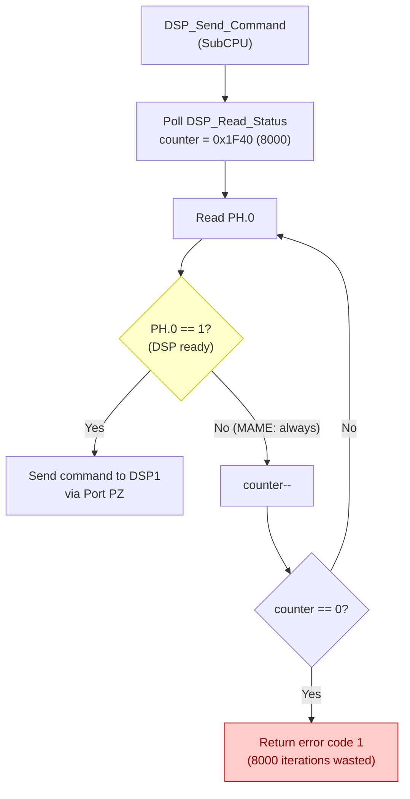
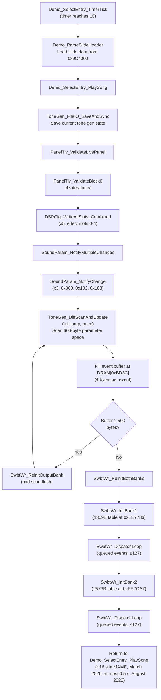
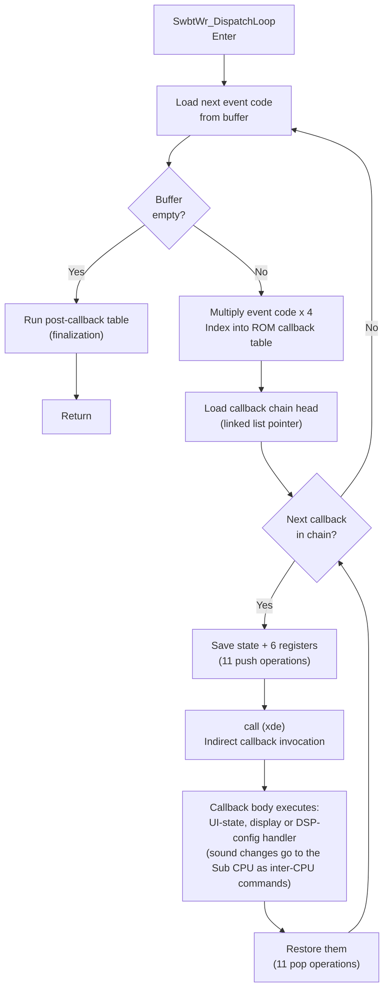
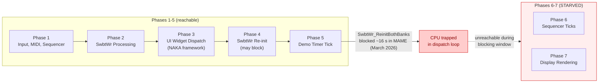

# Tone Generator Initialization (SwbtWr)

During Feature Demo, `SwbtWr_ReinitBothBanks` blocks the CPU while reinitializing the tone generator with new sound preset parameters. In MAME the stall lasted about 16 seconds (measured 2026-03-09, see [Feature Demo Timer Behaviour]({{ site.baseurl }}/feature-demo-investigation-2026-03-09/)). Later builds do not reproduce it. On the kn7000_mame overlay of 2026-08-15, the demo countdown at DRAM `0x0D2F` went from 10 to 9 in 0.51 s, against 0.07 to 0.10 s for every other step ([`notes/p9-countdown-2026-08-15.log`](https://github.com/ArqueologiaDigital/MAME_Technics_Research/blob/main/notes/p9-countdown-2026-08-15.log)). Ten is the value at which `Demo_ParseSlideHeader` and `Demo_SelectEntry_PlaySong` run, so the slide parse and the whole song setup, `SwbtWr_ReinitBothBanks` included, took at most half a second. An earlier version of this page blamed it for the SSF presentation never starting; that failure was later traced to event routing and is independent of the stall (see [SSF Presentation System]({{ site.baseurl }}/ssf-presentation/)).

This page documents the full initialization call graph, the event buffer system, the dispatch loop internals, and the impact on the main loop.

---

## Table of Contents

- [Overview](#overview)
- [Call Graph](#call-graph)
- [Event Buffer System](#event-buffer-system)
- [Dispatch Loop Detail](#dispatch-loop-detail)
- [Why It Took ~16 Seconds in March 2026](#why-it-took-16-seconds-in-march-2026)
- [DSP Status Polling Bug (March 2026 Discovery)](#dsp-status-polling-bug-march-2026-discovery)
- [Impact on NAKA Widget Framework](#impact-on-naka-widget-framework)
- [Flowcharts](#flowcharts)
- [Key Source Files](#key-source-files)
- [Related Pages](#related-pages)

---

## Overview

When the Feature Demo transitions to song playback, the firmware must reinitialize the tone generator hardware with the new sound preset's parameters. This is handled by `SwbtWr_ReinitBothBanks`, which processes two banks of tone generator events sequentially via `SwbtWr_DispatchLoop`. The entire operation is synchronous and blocking -- interrupts stay enabled, but there are no cooperative yield points, so the main loop does not advance for the duration.

While the loop runs, the rest of the main loop (UI dispatch, display rendering, the demo timer) does not advance.

---

## Call Graph

The full call hierarchy from the demo timer tick through the tone generator reinitialization:

```
Demo_SelectEntry_TimerTick
  -> Demo_ParseSlideHeader
  -> Demo_SelectEntry_PlaySong
       -> ToneGen_FileIO_SaveAndSync
            -> PanelTlv_ValidateLivePanel
                 -> PanelTlv_ValidateBlock0 (46 record validations, then)
                      -> DSPCfg_WriteAllSlots_Combined (x5: effect slots 0-4)
            -> SoundParam_NotifyMultipleChanges
                 -> SoundParam_NotifyChange (x3: parameters 0x000, 0x102, 0x103)
                 -> ToneGen_DiffScanAndUpdate (tail jump, once)
                      (scans 606-byte parameter space, fills event buffer)
                      (mid-scan flush at 500 bytes via SwbtWr_ReinitOutputBank)
       -> SwbtWr_ReinitBothBanks
            -> SwbtWr_InitBank1 (1309-byte table)
                 -> SwbtWr_DispatchLoop
            -> SwbtWr_InitBank2 (2573-byte table)
                 -> SwbtWr_DispatchLoop
```

The initialization begins when the demo timer reaches value 10, triggering `Demo_ParseSlideHeader` and `Demo_SelectEntry_PlaySong`. The song setup path first saves current tone generator state, reinitializes all DSP configuration entries (46 record validations, then one write per effect slot, 5 in all), then performs a diff scan of the 606-byte parameter space to determine which tone generator registers need updating.

---

## Event Buffer System

The event buffer is a central staging area for tone generator parameter changes:

| Property                               | Value                                                        |
|----------------------------------------|--------------------------------------------------------------|
| **Buffer location**                    | DRAM `0xBD3C`                                                |
| **Entry size**                         | 4 bytes per event                                            |
| **Batch capacity**                     | ~127 events per batch                                        |
| **Events per pass (MAME, 2026-03-09)** | ~113 and ~122 (the byte index at 0xC07B reached 452 and 488) |
| **Mid-scan flush threshold**           | 500 bytes (125 events)                                       |

### How Events Are Generated

`ToneGen_DiffScanAndUpdate` compares the current 606-byte parameter space against the new preset's parameters. For each byte that differs, it appends a 4-byte event record (event code, byte index, new value, changed bits = new XOR old). When the buffer reaches 500 bytes (125 events) during a scan, it triggers an early flush via `SwbtWr_ReinitOutputBank` to prevent overflow.

### Event Flow

```
Parameter diff scan (606 bytes)
  -> Generate 4-byte event per changed parameter
  -> Buffer at DRAM[0xBD3C]
  -> Flush when buffer hits 500 bytes (mid-scan)
  -> Final flush after scan completes
  -> SwbtWr_DispatchLoop processes all buffered events
```

---

## Dispatch Loop Detail

`SwbtWr_DispatchLoop` is the inner engine that hands each buffered event to the callbacks registered for its code. It processes events sequentially with no parallelism or batching optimization.

### Per-Event Processing Steps

1. **Load event code** from the buffer
2. **Index into ROM callback table** -- multiply event code by 4 to get the table offset
3. **Walk the callback chain** -- each table position holds a linked list of callbacks
4. **For each callback in the chain:**
   - Save the dispatcher state and registers (11 pushes: the words at RAM 0xC07B, 0xC081, 0xC083, 0xC085, 0xC087 and XWA, XBC, XDE, XHL, XIY, XIX)
   - Call the callback handler via indirect `call (xde)`
   - Restore them (11 pops)
5. **Advance to next event** in the buffer
6. **After all events:** run the post-callback table for finalization

### Bank Tables

| Bank   | ROM Address                            | Table Size | Contents                                    |
|--------|----------------------------------------|------------|---------------------------------------------|
| Bank 1 | `0xEE7786` (`SwbtBank1_ListenerTable`) | 1309 bytes | 192 code slots (0x00-0xBF) + listener lists |
| Bank 2 | `0xEE7CA7` (`Naka_RenderMode_A_Table`) | 2573 bytes | 192 code slots + listener lists             |

What most event codes mean is an open question in the disassembly; only 0x61 and 0x63-0x66 are tied to DSP blocks. Bank 1's lists name only six callbacks (panel-tag and MIDI-mode handlers, a demo-text and a bitmap probe). Bank 2's are mostly UI-state and display handlers (`UIState_KeyScan_Dispatch`, `UIState_ProcessKeyEvent`, `BitMapOut_ByteData_RenderB`, …) plus `EffEdit_DSPConfigBlock` and `DSPCfg_ProcessInput`. Both banks are processed sequentially by `SwbtWr_ReinitBothBanks`.

### Callback Body

Each callback reads the event back from RAM (code at 0xC080, payload at 0xC07D-0xC07F) and acts on it. The callbacks run on the Main CPU, which has no tone generator on its bus; anything that reaches IC303 or the DSPs goes to the Sub CPU as an inter-CPU command through the latch at 0x140000.

---

## Why It Took ~16 Seconds in March 2026

The ~16-second duration measured in March 2026 came from the combination of:

| Factor                           | Contribution                                            |
|----------------------------------|---------------------------------------------------------|
| ~235 events in two passes        | measured in MAME; a batch holds at most 127             |
| 11 pushes + 11 pops per callback | 22 stack operations per callback invocation             |
| Indirect call overhead           | `call (xde)` through linked list chain                  |
| Callback body execution          | UI-state, display and DSP-config handlers               |
| No yield points                  | the main loop does not advance; interrupts keep running |
| No batching                      | Each event processed individually                       |

Additionally, `MainLoop_ReinitSwbtWr` (in the main loop's phase 4) calls `SwbtWr_ReinitBothBanks` **again** on the next main loop iteration if the sequencer startup has queued additional events. This can extend the total blocking time beyond the initial window.

### Timing Breakdown

The ~16 s is a MAME measurement ([Feature Demo Timer Behaviour]({{ site.baseurl }}/feature-demo-investigation-2026-03-09/)). The dispatch overhead per event (11 pushes, 11 pops, one indirect call) is a few microseconds at 16 MHz, so the time is spent in the callback bodies. Why they took tens of milliseconds each in the March 2026 build was never established, and the August 2026 build no longer shows it; real hardware has not been timed.

---

## DSP Status Polling Bug (March 2026 Discovery)

> ⚠ **Retracted.** This diagnosis is wrong (kn5000-roms-disasm `dsp/analysis/second-dsp-and-ready.md` §0 A2-A4, 2026-07-27). The sub CPU's reset code writes `PHCR = 0x07` (`v142/subcpu/kn5000_subprogram_v142.s:80`), so PH.0 is an output. Under the port convention MAME implements, `DSP_Read_Status` reads back the latch it has just set, so READY is 1 on every poll and the 8,000-poll timeout never runs. PH.0 is IC311's (DSP1) ready line, not IC310's. In any case the poll runs on the Sub CPU, not in the Main CPU's dispatch loop. The MAME driver's `porth_read().set_constant(0x01)` changes nothing on PH.0; its only live bit is PH.3. The text below is kept as the record of the March 2026 hypothesis.

A significant contributor to the ~16-second blocking time was identified in the SubCPU's DSP communication layer.

### The Bug

SubCPU Port H bit 0 is not connected in MAME. The firmware's `DSP_Read_Status` routine (SubCPU address `0x0383F7`) reads PH.0 to determine whether DSP2 (IC310, MN19413) is ready to accept a command. Since the MAME Port H read callback returns 0 for all bits, the DSP always appears "busy."

### Impact

`DSP_Send_Command` and `DSP_Send_Data` both poll `DSP_Read_Status` in a tight loop with a timeout counter of `0x1F40` (8,000 iterations). Every DSP write operation spins through all 8,000 iterations before giving up and proceeding. Bank 2 — which handles DSP effects configuration (reverb, chorus, EQ, compressor) — triggers many DSP writes, each hitting the full timeout. This dramatically inflates the total blocking time.

### Firmware Code

The status-checking routine on the SubCPU:

```asm
DSP_Read_Status:
    calr DSP_Nop
    set 0, (PH:8)        ; Set bit 0 of PH latch (direction/output)
    ldcf 0, (PH:8)       ; Load carry from PH bit 0 (read external pin)
    scc8 c, l            ; L = 1 if ready (carry set), 0 if busy
    extz hl
    ret
```

### TMP94C241 Port Read Behavior

The TMP94C241's port read logic is: `(latch & dir) | (external & ~dir)`. With `dir=0` (input mode, the default after reset) and `external=0` (no callback bound in MAME), PH.0 is always read as 0 — the DSP perpetually appears busy.

### The Fix

Connect the SubCPU's Port H read callback to return `0x01` (DSP ready), matching real hardware behavior where the DSP chip asserts its ready line after accepting a command. This is a one-line change in the MAME driver.

### Expected Impact

Eliminates thousands of wasted timeout iterations per `SwbtWr_ReinitBothBanks` call, dramatically reducing the ~16-second blocking time. Each DSP write that previously burned 8,000 loop cycles will complete in a single iteration.

### DSP Polling Flowchart



---

## Impact on NAKA Widget Framework

The main loop (`MainLoop`, `v10/maincpu/boot/system_handlers.s:1115-1248`) calls, in this order within one iteration: `SwbtWr_ProcessAll` (:1187), `MainTitle_PrepareAndDispatch` (:1190), `MainLoop_ReinitSwbtWr` (:1191), …, `Demo_SelectEntry_TimerTick` (:1217), …, `Display_DirtyRegionDispatch` (:1245). The phase numbers below are this page's grouping, not the source's:

| Phase | Function               | Description                                                                              |
|-------|------------------------|------------------------------------------------------------------------------------------|
| 1     | Input, MIDI, sequencer | Panel and MIDI input, first sequencer ticks (:1116-1184)                                 |
| 2     | SwbtWr processing      | `SwbtWr_ProcessAll` (:1187)                                                              |
| 3     | UI widget dispatch     | `MainTitle_PrepareAndDispatch` (:1190) -- NAKA framework processing                      |
| **4** | **SwbtWr re-init**     | **`MainLoop_ReinitSwbtWr` (:1191) -- MAY BLOCK**                                         |
| **5** | **Demo timer tick**    | **`Demo_SelectEntry_TimerTick` (:1217) reaches `SwbtWr_ReinitBothBanks` -- BLOCKS HERE** |
| 6     | Sequencer ticks        | `Seq_TickWrapper`, `Seq_EventProcessingTick`, `SeqStep_MainTimerTick` (:1239-1244)       |
| 7     | Display rendering      | `Display_DirtyRegionDispatch` (:1245) -- VRAM updates                                    |

### Consequences of Blocking

⚠ The consequences below are the March 2026 hypothesis; see the note at the top of this page.

- **Nothing after the demo tick in that iteration runs**, and the next iteration's UI dispatch and display rendering wait until `SwbtWr_ReinitBothBanks` returns
- The Feature Presentation screen's **widget activation requires multiple main loop passes** through phase 3 (UI widget dispatch)
- The **screen activation event `0x1C00001`** cannot be processed, so `SetCurrentTarget` is never called for the Feature Presentation screen
- Without `CurrentTarget` being set correctly, **broadcast event `0x1C00038`** is routed to the wrong widget handler
- The **SSF visual presentation never starts** because `GroupBoxProc_StartSSFPresentation` is never invoked
- **No display updates** occur during blocking -- the LCD shows a frozen frame
- **No input polling** occurs -- button presses during the blocking window are lost

This is the mechanism by which the tone generator initialization starves the NAKA widget framework and prevents the SSF presentation from activating. See [SSF Presentation System]({{ site.baseurl }}/ssf-presentation/#known-bug-mame-ssf-never-activates) for the full analysis of this failure mode.

---

## Flowcharts

### Full Initialization Sequence



### Dispatch Loop Detail



### Main Loop Phase Diagram



---

## Key Source Files

| Source File                 | Key Functions                                                                                    | Purpose                                                 |
|-----------------------------|--------------------------------------------------------------------------------------------------|---------------------------------------------------------|
| `system_handlers.s`         | `SwbtWr_ReinitBothBanks` (line 1419), main loop (line 1115), `MainLoop_ReinitSwbtWr` (line 1271) | Main loop and SwbtWr entry points                       |
| `dsp_config_sysex.s`        | `SwbtWr_InitBank1`, `SwbtWr_InitBank2`, `SwbtWr_InitBank3`, `SwbtWr_DispatchLoop`                | Bank initialization and event dispatch loop             |
| `audio_control_engine.s`    | `SwbtWr_FlushAndAppendParams`, `SwbtWr_WriteParamBlock`                                          | Event buffer management and parameter writes            |
| `tonegen_fileio_handlers.s` | `ToneGen_FileIO_SaveAndSync`, `ToneGen_DiffScanAndUpdate`                                        | Tone gen state save/restore and parameter diff scanning |
| `file_demo_proc.s`          | `Demo_SelectEntry_TimerTick`, `Demo_SelectEntry_PlaySong`                                        | Demo timer state machine and song playback initiation   |

All source files are in kn5000-roms-disasm's `v10/maincpu/` tree: `boot/system_handlers.s`, `audio/dsp_config_sysex.s`, `audio/audio_control_engine.s`, `audio/tonegen_fileio_handlers.s` and `demo/file_demo_proc.s`.

---

## Related Pages

- [SSF Presentation System]({{ site.baseurl }}/ssf-presentation/) -- Full SSF analysis, including the MAME activation bug (since traced to event routing, not to SwbtWr blocking)
- [Feature Demo]({{ site.baseurl }}/feature-demo/) -- Feature Demo investigation history and timer bugs
- [Tone Generator]({{ site.baseurl }}/tone-generator/) -- Tone gen hardware registers and voice management
- [Audio Subsystem]({{ site.baseurl }}/audio-subsystem/) -- Audio architecture overview
- [Sound Parameter Protocol]({{ site.baseurl }}/sound-parameter-protocol/) -- Parameter change notification system
- [UI Framework]({{ site.baseurl }}/ui-framework/) -- NAKA widget framework (starved by blocking)

---

*Last reviewed against kn5000-roms-disasm 3417969c0 (2026-10-06).*
